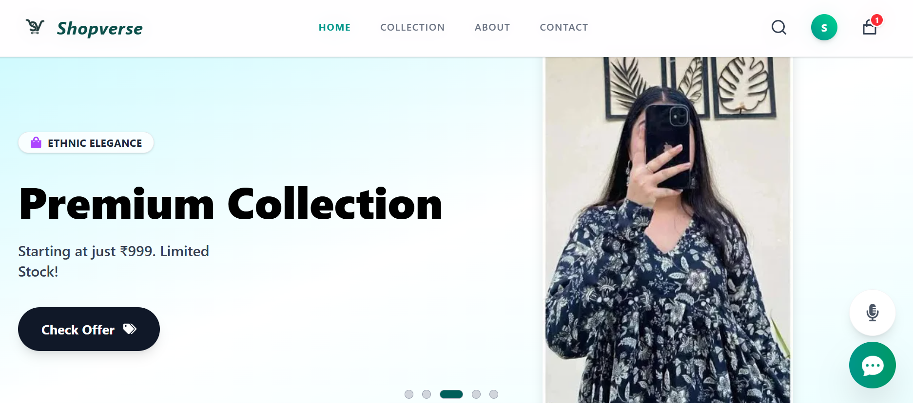
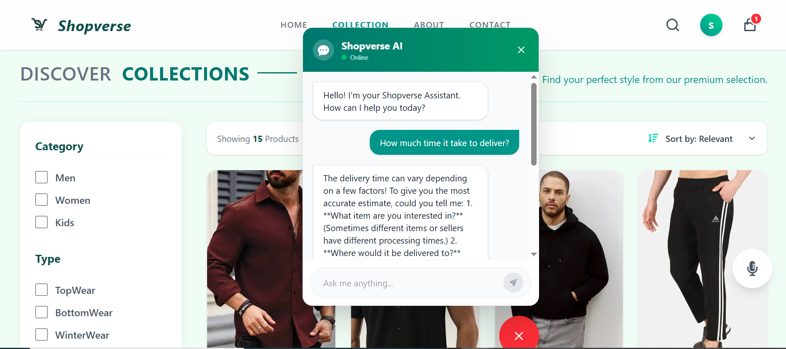
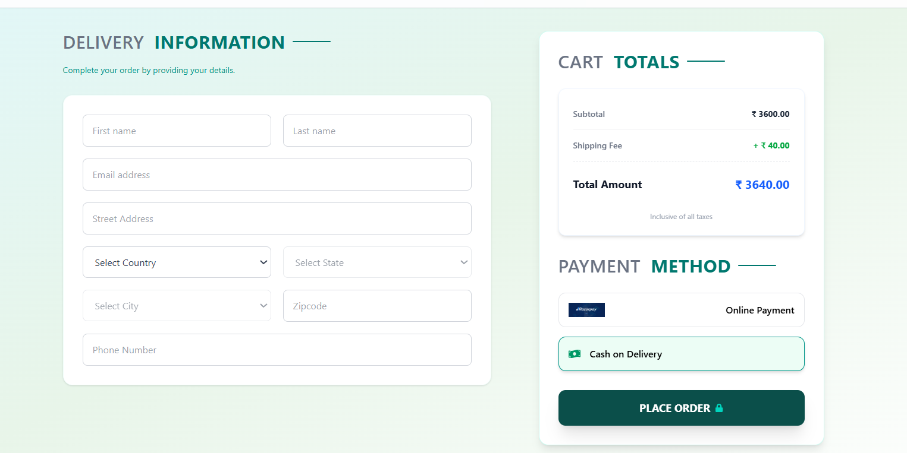

# 🛍️ ShopVerse – An AI-Powered E-Commerce Platform

<p align="center">

  **Discover. Shop. Experience Smarter Shopping.**

</p>

ShopVerse is a full-stack e-commerce platform built using the **MERN Stack**, designed to provide a seamless and intelligent online shopping experience.

It combines modern e-commerce functionality with AI integration, secure payment processing, and efficient product management to make online shopping smarter, simpler, and more convenient.

🌐 **Live Demo:** [ShopVerse](https://shopverse-pi.vercel.app/)

---

## ✨ Key Features

- **🛒 Product Browsing:** Explore products through an interactive shopping interface.
- **🤖 AI Integration:** Google AI API integration to enhance the shopping experience.
- **🔐 User Authentication:** Secure user registration and login functionality.
- **💳 Online Payments:** Integrated Razorpay payment gateway for secure transactions.
- **🖼️ Image Management:** Cloudinary integration for product image storage and management.
- **📦 Order & Delivery:** Dedicated order and delivery experience.
- **⚡ Dynamic Product Management:** Fetch and display product data through backend APIs.
- **📱 Responsive UI:** User-friendly interface optimized for different screen sizes.

## 📸 Project Screenshots

### 🏠 Home Page

<p align="center">
  
</p>

### 🤖 AI Integration

<p align="center">
  
</p>

### 📦 Order & Delivery

<p align="center">
  
</p>

---

## 🛠️ Tech Stack

| Category | Technologies |
|---|---|
| Frontend | React.js |
| Backend | Node.js, Express.js |
| Database | MongoDB |
| AI Integration | Google AI API |
| Authentication | JWT |
| Image Storage | Cloudinary |
| Payment Gateway | Razorpay |
| Frontend Deployment | Vercel |
| Backend Deployment | Render |

---

## ⚙️ Getting Started

Follow these steps to run ShopVerse locally.

### 1. Clone the Repository

```bash
git clone <your-github-repository-url>
cd ShopVerse
```

### 2. Install Dependencies

**Backend:**

```bash
cd backend
npm install
```

**Frontend:**

Open another terminal:

```bash
cd frontend
npm install
```

### 3. Configure Environment Variables

Create a `.env` file inside the backend directory and configure the required environment variables.

Example:

```env
PORT=5000
MONGO_URI=your_mongodb_connection_string
JWT_SECRET=your_jwt_secret

CLOUDINARY_CLOUD_NAME=your_cloud_name
CLOUDINARY_API_KEY=your_api_key
CLOUDINARY_API_SECRET=your_api_secret

RAZORPAY_KEY_ID=your_razorpay_key
RAZORPAY_KEY_SECRET=your_razorpay_secret

GOOGLE_AI_API_KEY=your_google_ai_api_key
```

Use the exact variable names expected by your application.

**Note:** Never commit your `.env` file or expose sensitive credentials on GitHub.

### 4. Run the Application

Start the backend:

```bash
cd backend
npm run dev
```

Start the frontend in a separate terminal:

```bash
cd frontend
npm run dev
```

Open the local URL displayed by the frontend development server to access ShopVerse.

---

## 🚀 Deployment

ShopVerse uses separate deployment platforms for its frontend and backend.

| Component | Platform |
|---|---|
| Frontend | Vercel |
| Backend | Render |
| Database | MongoDB Atlas |
| Media Storage | Cloudinary |

**Live Application:** [Visit ShopVerse](https://shopverse-pi.vercel.app/)

---

## 🎯 Project Objectives

- Build a seamless and user-friendly e-commerce experience.
- Integrate AI capabilities into online shopping.
- Implement secure authentication and payment processing.
- Manage product images efficiently using cloud storage.
- Develop a scalable full-stack application using MERN technologies.

## 🔮 Future Enhancements

- Personalized AI-powered product recommendations.
- Advanced product filtering and search.
- Enhanced order tracking and management.
- Improved shopping analytics.
- Personalized shopping experiences.

---

## 👩‍💻 Author

**Milly Jain**

B.Tech Computer Science & Engineering

- GitHub: [millyjain09](https://github.com/millyjain09)
- LinkedIn: [Milly Jain](https://linkedin.com/in/milly-jain/)

---

<p align="center">

  **Built with ❤️ to make online shopping smarter.**

  *Discover. Shop. Experience ShopVerse.*

</p>
